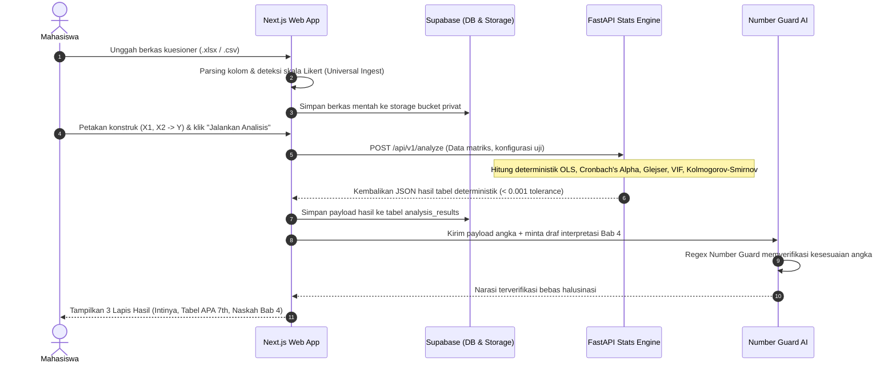
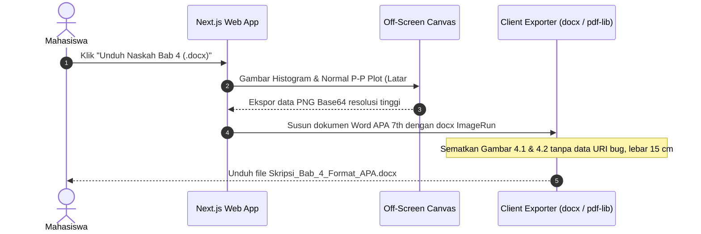
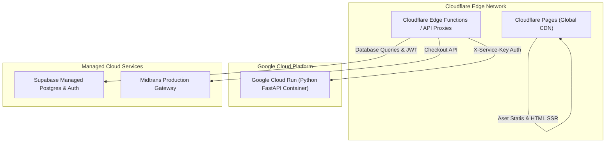

# OlahData System Architecture Specification

> **Versi Arsitektur:** 2.0  
> **Terakhir Diperbarui:** 24 Oktober 2026  
> **Status:** Acuan Resmi Desain & Implementasi Sistem OlahData

---

## 1. Ringkasan Eksekutif & Topologi Sistem

OlahData adalah platform berbasis web modern untuk pengolahan data kuesioner penelitian skripsi kuantitatif (khususnya skala Likert). Arsitektur dirancang untuk memecahkan kelemahan software statistik desktop konvensional (SPSS/Stata) dengan mengintegrasikan:
1. **Mesin Statistik Deterministik Matematis**: Komputasi berbasis Python OLS (`numpy`, `scipy`, `statsmodels`) dengan toleransi absolut $< 0,001$ terhadap benchmark R dan JASP.
2. **Sistem Penjaga Angka (*Number Guard*)**: Lapisan verifikasi deterministik yang memastikan narasi interpretasi akademis dari model bahasa tidak pernah memuat angka halusinasi.
3. **Penyusunan Bab 4 Otomatis**: Generator tabel 3-garis standar APA Edisi ke-7, grafik residual resolusi tinggi, dan ekspor langsung ke Microsoft Word (`.docx`) dan PDF.

### Topologi Arsitektur Monorepo

```mermaid
graph TD
    Client["Klien Web / Mobile (Browser)"]
    
    subgraph Frontend["Frontend & BFF Layer (apps/web)"]
        NextApp["Next.js 16.4.3 App Router"]
        ClientEngine["Client-Side Fallback Engine (TypeScript)"]
        DocxGen["Word APA Generator (docx ImageRun)"]
        PdfGen["PDF Generator (pdf-lib)"]
        Zustand["Zustand State Store"]
        NumGuard["Number Guard AI Validator"]
    end
    
    subgraph Microservice["Statistical Microservice (services/stats)"]
        FastAPI["FastAPI 0.110+ (Python 3.10)"]
        Engine["Statistical Engine (NumPy, SciPy, Statsmodels)"]
        PlotGen["Plot Generator (Matplotlib / Seaborn)"]
    end
    
    subgraph CloudInfra["Backend as a Service & Pembayaran"]
        SupaAuth["Supabase Auth (JWT & Email)"]
        SupaDB[("Supabase PostgreSQL (12 Tables, RLS)")]
        SupaStorage["Supabase Private Storage (datasets bucket)"]
        Midtrans["Midtrans Payment Gateway (Snap / Core API)"]
    end

    Client -->|HTTPS / UI Interaksi| NextApp
    NextApp -->|Universal Ingest & Local Cache| Zustand
    NextApp -->|Kalkulasi Ringan & Standalone| ClientEngine
    NextApp -->|REST API + X-Service-Key| FastAPI
    FastAPI -->|Eksekusi Matriks OLS & Asumsi| Engine
    Engine -->|Hasil Deterministik JSON| FastAPI
    NextApp -->|Verifikasi Narasi AI| NumGuard
    NextApp -->|Ekspor .docx Asli| DocxGen
    NextApp -->|Ekspor PDF Vektor| PdfGen
    NextApp -->|Sesi & RLS Queries| SupaDB
    NextApp -->|Simpan Berkas Kuesioner| SupaStorage
    NextApp -->|Buat Token Pembayaran| Midtrans
    Midtrans -->|Webhook HMAC SHA-512| NextApp
```

---

## 2. Prinsip Arsitektur Utama (*Core Principles*)

### A. Komputasi 100% Deterministik
* Seluruh operasi matematika (validitas Pearson, reliabilitas Cronbach's Alpha, regresi linier berganda OLS, uji multikolinearitas VIF, uji heteroskedastisitas Glejser, dan uji Kolmogorov-Smirnov) dihitung secara deterministik.
* **Large Language Models (LLM) DILARANG KERAS** menghitung, menebak, mengubah, atau membulatkan angka responden.

### B. Kebijakan Tanpa Halusinasi (*Zero-Hallucination & Number Guard*)
* Narasi interpretasi akademik yang dihasilkan AI wajib melewati regex *Number Guard* sebelum disajikan ke pengguna.
* Setiap token angka pada narasi dicocokkan dengan payload tabel hasil kalkulasi Python. Jika terdeteksi angka yang tidak terdaftar, narasi ditolak seketika (*fail-closed*), dan sistem menampilkan tabel murni tanpa teks halusinasi.

### C. Imutabilitas Dataset & Integritas Akademik
* Data kuesioner mentah yang diunggah pengguna bersifat kekal (*immutable*).
* Sistem tidak pernah melakukan imputasi data otomatis, membuat responden palsu, atau mengubah jawaban asli.
* Jika pengguna mengeluarkan responden pencilan (*outlier*), operasi tersebut menghasilkan *derived dataset version* baru dengan catatan jejak audit (*audit trail*) eksplisit.

### D. Satu Sumber Data Visualisasi & Ekspor
* Grafik di antarmuka web, berkas Microsoft Word (`.docx`), dan dokumen PDF menggunakan array data hasil kalkulasi yang persis sama.
* Render grafik ekspor dilakukan secara *off-screen* dengan tema cetak hitam-putih kontras tinggi pada resolusi minimal 2x *devicePixelRatio*.

---

## 3. Rincian Modul & Komponen Monorepo

### A. Frontend Web (`apps/web`)
* **Framework**: Next.js 16.4.3 (App Router), React 19, TypeScript 5.8, Tailwind CSS v4.
* **Manajemen State**: Zustand (`useWorkspaceStore`) untuk sinkronisasi dataset, pemetaan variabel, dan riwayat analisis lokal.
* **Universal Ingest Parser**: Mendukung berkas `.csv`, `.xlsx`, `.xls`, tab-delimited, dan Google Sheets XML dengan deteksi otomatis baris header dan pemisahan variabel demografi vs butir instrumen skala Likert.
* **Engine Dual-Mode**:
  - *Full Service Mode*: Memanggil microservice Python FastAPI untuk beban kerja intensif dan laporan terlengkap.
  - *Edge / Client Fallback Mode*: Melakukan komputasi OLS dan statistik dasar langsung di browser menggunakan modul TypeScript (`apps/web/src/lib/stats-engine.ts`) ketika koneksi offline atau microservice sedang dalam proses *cold-start*.

### B. Mesin Statistik Python (`services/stats`)
* **Framework**: FastAPI (Python 3.10), Uvicorn.
* **Pustaka Komputasi**: `numpy`, `scipy`, `pandas`, `statsmodels`.
* **Arsitektur Pipeline Terisolasi**:
  - `engine/ingest.py`: Validasi tipe data kuesioner, penanganan missing values (listwise deletion dengan log audit).
  - `engine/descriptive.py`: Perhitungan Mean, Median, Modus, Varians, Standar Deviasi, Skewness, Kurtosis.
  - `engine/validity.py`: Korelasi Pearson Product-Moment butir terhadap skor total ($r_{hitung} \ge r_{tabel}$).
  - `engine/reliability.py`: Uji konsistensi internal Cronbach's Alpha per konstruk variabel.
  - `engine/regression.py`: Regresi OLS multivariat ($\hat{Y} = \beta_0 + \beta_1 X_1 + \dots + \beta_k X_k$), uji simultan $F$, uji parsial $t$, koefisien determinasi $R^2$ dan Adjusted $R^2$.
  - `engine/assumptions.py`:
    - Uji Normalitas Residual: Kolmogorov-Smirnov & Shapiro-Wilk.
    - Uji Multikolinearitas: Variance Inflation Factor ($VIF$) & Tolerance ($1/VIF$).
    - Uji Heteroskedastisitas: Uji Glejser (regresi nilai absolut residual terhadap variabel independen).
    - Uji Linearitas: ANOVA *Test for Linearity* dan *Deviation from Linearity*.

### C. Basis Data & Autentikasi (`supabase/`)
* **Engine**: PostgreSQL 15 via Supabase.
* **Keamanan Baris (Row Level Security / RLS)**: Ditegakkan pada seluruh 12 tabel:
  - `profiles`: Data pengguna dan status langganan.
  - `projects`: Metadata penelitian mahasiswa (judul, kampus, fakultas).
  - `datasets`: Berkas kuesioner terunggah beserta riwayat derivasinya.
  - `analysis_runs`: Jejak hitung parameter dan waktu eksekusi.
  - `analysis_results`: Payload JSON tabel hasil analisis.
  - `subscriptions`: Catatan tagihan dan hak akses fitur.
  - `audit_logs`: Log kepatuhan UU PDP (Pelindungan Data Pribadi).
* **Storage Bucket**: Bucket privat `datasets` dengan pembatasan akses berbasis path `{user_id}/*`.

### D. Gateway Pembayaran & Entitlement (`midtrans`)
* **Integrasi**: Midtrans Snap dan Core API.
* **Metode Pembayaran**: QRIS (GoPay, OVO, ShopeePay), Transfer Virtual Account (BCA, Mandiri, BNI, BRI), dan kartu kredit.
* **Verifikasi Webhook**: Menghitung hash HMAC SHA-512 dari kombinasi `order_id + status_code + gross_amount + ServerKey` untuk mencegah pemalsuan callback.
* **Matriks Hak Akses (Entitlements)**:
  - `free`: Analisis tanpa batas di web, ekspor Word/PDF disertai *watermark*.
  - `monthly` / `thesis`: Ekspor bersih tanpa *watermark*, prioritas komputasi, dan unduhan berkas lampiran lengkap.

---

## 4. Diagram Alur Sistem (Sequence Diagrams)

### A. Alur Analisis Data Kuesioner (Upload to Output)

### B. Alur Ekspor Microsoft Word (.docx) & PDF

---

## 5. Standar Validasi & Pengujian Matematis

Untuk menjamin keandalan data skripsi mahasiswa saat sidang pendadaran, sistem OlahData dilengkapi rangkaian pengujian otomatis (*automated test suite*):
1. **Fixture Benchmark R & JASP**: Dataset referensi baku (`services/stats/tests/fixtures/reference/dataset_reference.csv`) diuji secara periodik. Seluruh nilai koefisien regresi ($B$, $\beta$), $t$-statistik, signifikansi ($p$), $F$-hitung, $R^2$, dan reliabilitas wajib memiliki deviasi $< 0,0001$ terhadap output R `lm()` dan SPSS.
2. **Uji Invarian & Adversarial**:
   - Skala invarian: Mengalikan butir dengan konstanta tidak mengubah korelasi Pearson.
   - Pengecekan matriks singular: Mencegah *divide-by-zero* pada data jawaban responden yang seragam (*zero-variance*).
3. **Number Guard Test Suite**: Memastikan kalimat dengan angka yang tidak bersumber dari tabel otomatis ditolak 100%.

---

## 6. Arsitektur Deployment & DevOps

* **Frontend**: Di-deploy pada **Cloudflare Pages** dengan kompresi Brotli, caching global, dan latensi rendah di seluruh Indonesia.
* **Backend Komputasi**: Di-deploy pada **Google Cloud Run** menggunakan arsitektur serverless container (*scale-to-zero* saat menganggur untuk efisiensi biaya operasional solopreneur).
* **Keamanan Komunikasi**: Komunikasi antara Next.js dan microservice Python dilindungi oleh header internal rahasia `X-Service-Key` dan validasi CORS ketat.
