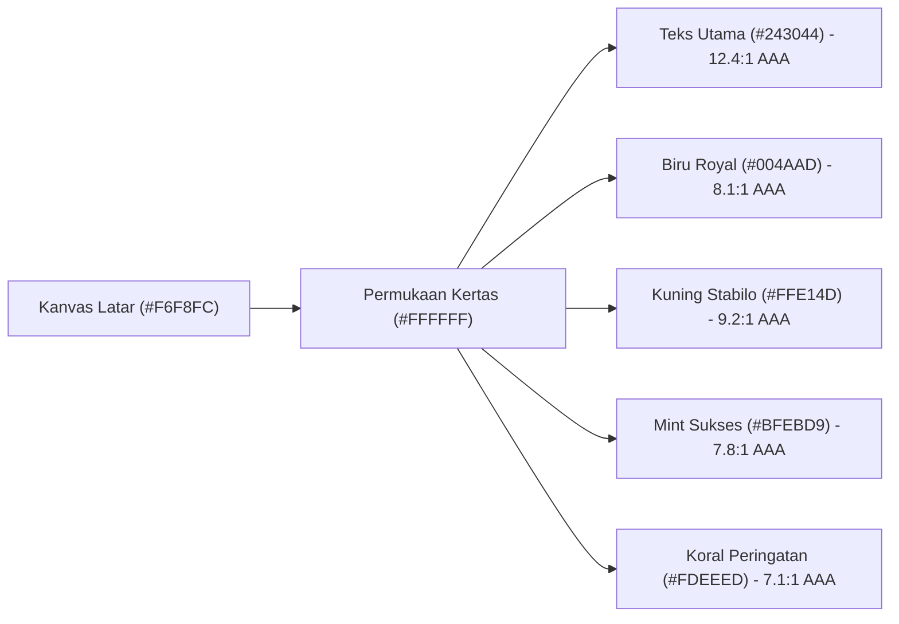

# OlahData Design System: Teman Belajar yang Pintar

> **Versi Dokumentasi:** 2.0  
> **Terakhir Diperbarui:** 24 Oktober 2026  
> **Status:** Acuan Resmi Desain & Implementasi Frontend OlahData

---

## 1. Filosofi & Visi Desain

OlahData dirancang dengan prinsip **"Teman Belajar yang Pintar"** (*The Friendly & Brilliant Study Buddy*). Mahasiswa tingkat akhir yang sedang menyusun skripsi kuantitatif sering mengalami tingkat kecemasan tinggi (*statistics anxiety*) saat berhadapan dengan software statistik konvensional (seperti SPSS, Stata, atau SAS) yang kaku, penuh jargon, dan mengintimidasi.

### Pilar Pengalaman Pengguna (UX Pillars)
1. **Menghilangkan Kecemasan (*Calm & Reassuring*)**: Antarmuka menggunakan metafora meja belajar yang rapi dan hangat — kertas catatan, sapuan stabilo kuning, dan tinta pulpen — bukan tampilan spreadsheet abu-abu yang dingin.
2. **Kejelasan Bertahap (*Progressive Disclosure*)**: Angka statistik tidak disajikan sekaligus secara mentah. Setiap uji menyajikan **3 Lapis Penjelasan**:
   - **Lapis 1 (Intinya)**: Kesimpulan praktis dalam 1 kalimat bahasa Indonesia yang lugas.
   - **Lapis 2 (Tabel Akademik)**: Tabel format jurnal APA Edisi ke-7 siap salin ke Microsoft Word.
   - **Lapis 3 (Naskah Bab 4)**: Draf narasi pembahasan akademis lengkap dengan nomor tabel dan interpretasi nilai p.
3. **Pemberdayaan Intelektual (*Explain, Don't Obscure*)**: Mahasiswa tidak dibiarkan bingung oleh istilah statistik. Setiap metrik dilengkapi fitur *"Apa artinya?"* (penjelasan konseptual santai) dan *"Perlu dilakukan apa?"* (solusi perbaikan konkret jika asumsi tidak terpenuhi).
4. **Presisi Format Indonesia (`id-ID`)**: Seluruh penyajian angka menggunakan format koma desimal (`0,000`), titik ribuan (`1.250`), dan angka berjarak tetap (*tabular numbers*) untuk perataan vertikal yang sempurna.

---

## 2. Tipografi & Hirarki Teks

### A. Keluarga Font (*Font Families*)
Sistem menggunakan dua keluarga font yang dioptimalkan melalui `next/font/google`:

```css
:root {
  --font-sans: 'Figtree', system-ui, -apple-system, sans-serif;
  --font-mono: 'JetBrains Mono', ui-monospace, monospace;
}
```

* **Font Utama UI & Teks (`Figtree`)**:
  - Dipilih karena bentuk geometrisnya yang hangat, kurva terbuka, dan keterbacaan (*legibility*) yang luar biasa pada layar ponsel 360px hingga monitor desktop 1440px.
  - Memiliki *x-height* yang proporsional sehingga nyaman dibaca berjam-jam saat merevisi skripsi.
  - Mendukung set karakter bahasa Indonesia lengkap serta fitur angka tabular (*tabular numerals*).
* **Font Monospace / Formula (`JetBrains Mono`)**:
  - Digunakan khusus pada penulisan rumus regresi, jejak hitung matematika, blok kode, dan representasi matriks deterministik.

### B. Aturan Wajib Angka Tabular (*Tabular Numbers*)
Semua angka dalam tabel hasil Bab 4, kartu statistik, dan metrik wajib menggunakan kelas Tailwind `tabular-nums` atau properti CSS:
```css
font-variant-numeric: tabular-nums;
```
Hal ini memastikan setiap karakter angka memiliki lebar horizontal yang identik, sehingga tanda koma desimal dan digit sejajar secara vertikal.

### C. Skala Ukuran & Ritme Vertikal
| Peran Tipografi | Ukuran Font | Line Height | Font Weight | Tracking | Penggunaan |
| :--- | :--- | :--- | :--- | :--- | :--- |
| **Display / Hero** | `32px – 40px` | `1.2` | `700 (Bold)` | `-0.02em` | Judul utama landing page & modul utama |
| **Heading 1 (H1)** | `24px – 28px` | `1.3` | `700 (Bold)` | `-0.01em` | Judul halaman workspace & judul bab hasil |
| **Heading 2 (H2)** | `18px – 20px` | `1.4` | `600 (Semibold)`| `-0.005em`| Nama sub-uji (Regresi, Validitas, Asumsi) |
| **Heading 3 (H3)** | `15px – 16px` | `1.5` | `600 (Semibold)`| `0` | Sub-judul tabel & label kartu |
| **Body (Isi Bacaan)**| **`16px`** | **`1.625` (26px)**| `400 (Regular)` | `0` | Paragraf bacaan, naskah Bab 4 (Maks. 68 karakter per baris) |
| **Tabel & Data** | `14px – 15px` | `1.4` | `400 / 600` | `0` | Isi sel tabel APA 7th (dengan `tabular-nums`) |
| **Caption / Mikro**| `12px – 13px` | `1.4` | `500 (Medium)`  | `0.01em` | Keterangan sumber tabel, catatan kaki, sumbu grafik |

---

## 3. Palet Warna & Token Semantik

Palet warna OlahData dirancang dengan rasio kontras tinggi yang melampaui standar **WCAG 2.2 Level AA (&ge; 4.5:1)** dan sebagian besar mencapai **Level AAA (&ge; 7.0:1)**.

### A. Palet Mode Terang (Default — Meja Belajar Kertas)



| Nama Token Semantik | Nilai Hex | Peran & Penggunaan | Rasio Kontras | Kepatuhan WCAG |
| :--- | :--- | :--- | :--- | :--- |
| `--bg-paper` | `#F6F8FC` | Latar kanvas utama aplikasi (putih kebiruan lembut, mengurangi silau). | Latar dasar | - |
| `--surface-paper` | `#FFFFFF` | Permukaan lembar kerja, kartu modul, dialog modal, dan tabel. | 1.05:1 thd kanvas | Membedakan bidang |
| `--ink-text` | `#243044` | Teks tubuh utama, judul tabel, label instruksi. | **12.4:1** | **WCAG AAA** |
| `--text-secondary` | `#3E4D66` | Teks pendukung, deskripsi langkah wizard, sub-label. | **8.1:1** | **WCAG AAA** |
| `--text-muted` | `#526077` | Keterangan mikro, nomor butir kuesioner, teks tanggal. | **6.0:1** | **WCAG AA** |
| `--brand-royal` | `#004AAD` | Aksi utama (*primary button*), tautan navigasi, ikon sorotan. | **8.1:1** | **WCAG AAA** |
| `--brand-indigo` | `#1800AD` | Status hover tombol utama dan penekanan interaktif. | **10.5:1** | **WCAG AAA** |
| `--highlighter-yellow`| `#FFE14D` | **Khusus** sorotan angka yang tersambung antara naskah dan tabel. | Latar sorotan | - |
| `--text-on-accent` | `#243044` | Teks di atas Kuning Stabilo (wajib teks gelap). | **9.2:1** | **WCAG AAA** |
| `--mint-success-bg` | `#BFEBD9` | Latar badge hasil uji valid, reliabel, atau lulus asumsi. | Latar badge | - |
| `--mint-success-text`| `#0E4331` | Teks status uji lulus (hijau pinus gelap). | **7.8:1** | **WCAG AAA** |
| `--coral-warning-bg` | `#FDEEED` | Latar kotak peringatan asumsi dilanggar atau butir gugur. | Latar alert | - |
| `--coral-warning-text`| `#8A1E18` | Teks peringatan dan pesan perbaikan. | **7.1:1** | **WCAG AAA** |
| `--border-subtle` | `#E2E7F0` | Garis pemisah antar-bagian dan garis tabel APA 7th. | 1.2:1 | Khusus pemisah pasif |
| `--border-strong` | `#CBD5E1` | Batas kartu interaktif, input field, dan dropdown. | 1.5:1 | Kontur kontrol |

### B. Palet Mode Gelap (Meja Belajar Malam Hari)
Mode gelap OlahData menghindari hitam murni (`#000000`) untuk mencegah kelelahan mata (*halation effect*), menggunakan nuansa biru-malam pekat (*Midnight Slate*).

| Nama Token Semantik | Nilai Hex | Peran & Penggunaan | Rasio Kontras | Kepatuhan WCAG |
| :--- | :--- | :--- | :--- | :--- |
| `--bg-paper` | `#0E131F` | Kanvas latar malam pekat. | Latar dasar | - |
| `--surface-paper` | `#161E2E` | Permukaan kartu dan lembar hasil malam. | Permukaan dasar | - |
| `--ink-text` | `#F1F5F9` | Teks tubuh utama terang kontras tinggi. | **12.5:1** | **WCAG AAA** |
| `--text-secondary` | `#CBD5E1` | Teks sekunder mode malam. | **8.8:1** | **WCAG AAA** |
| `--text-muted` | `#A3B3CC` | Keterangan mikro malam (dinaikkan dari #94A3B8 agar lolos AA). | **5.2:1** | **WCAG AA** |
| `--brand-royal` | `#5D7BFA` | Aksi utama mode malam. | **6.5:1** | **WCAG AA** |
| `--highlighter-yellow`| `#FFE14D` | Kuning Stabilo malam (dipadukan dengan teks pekat `#0E131F`). | **9.5:1** | **WCAG AAA** |
| `--mint-success-bg` | `#1D4738` | Latar badge status lulus mode malam. | Latar badge | - |
| `--mint-success-text`| `#A8F0D0` | Teks status lulus mode malam. | **7.4:1** | **WCAG AAA** |
| `--coral-warning-bg` | `#381A18` | Latar peringatan mode malam. | Latar alert | - |
| `--coral-warning-text`| `#FFA8A3` | Teks peringatan mode malam. | **7.8:1** | **WCAG AAA** |

---

## 4. Skala Spasi, Radius, & Elevasi

### A. Skala Spasi 4-pt Tunggal
Sistem tata letak mengikuti kelipatan 4 piksel untuk menjaga ritme visual yang konsisten:
- `--space-1` (`4px`): Jarak mikro antar ikon dan label teks.
- `--space-2` (`8px`): Padding vertikal sel tabel, padding tombol kecil.
- `--space-3` (`12px`): Padding internal kartu ringkasan, celah antar tombol.
- `--space-4` (`16px`): Padding standar kontainer, celah grid modul.
- `--space-6` (`24px`): Jarak vertikal antar-seksi hasil uji Bab 4.
- `--space-8` (`32px`): Jarak antar langkah wizard analisis.
- `--space-12` (`48px`): Padding seksi halaman landing.
- `--space-16` (`64px`): Jarak batas hero banner.

### B. Radius Sudut Bertingkat (*Tiered Radius*)
Radius sudut mencerminkan peran fisik objek di antarmuka:
* **Tabel & Sel (`--radius-sm: 6px`)**: Mempertahankan ketegasan baris data statistik tanpa sudut membulat berlebihan.
* **Elemen Interaktif (`--radius-md: 10px`)**: Tombol, input teks, filter dropdown, dan tab navigasi. Nyaman disentuh dengan target sentuh &ge; 44px.
* **Kartu & Panel (`--radius-xl: 16px`)**: Kartu hasil analisis, kotak penjelasan, dan dialog modal. Memberikan kesan lembaran kertas catatan yang rapi.

### C. Elevasi Tanpa Bayangan Abu-Abu Kotor (*Clean Surface Elevation*)
OlahData tidak menggunakan efek *drop-shadow* buram tebal yang membuat antarmuka kotor. Bidang dipisahkan melalui:
1. Perbedaan warna latar: Kanvas `--bg-paper` (`#F6F8FC`) versus Lembar Kartu `--surface-paper` (`#FFFFFF`).
2. Garis batas halus: `1px solid var(--border-subtle)` (`#E2E7F0`).
3. Sentuhan bayangan lembut tipis hanya pada elemen mengambang (*floating navbar*, *popover*, *modal*):
   ```css
   box-shadow: 0 10px 25px -5px rgba(0, 74, 173, 0.06), 0 8px 10px -6px rgba(0, 74, 173, 0.04);
   ```

---

## 5. Komponen Utama & Pola Antarmuka (UX Patterns)

### A. Tabel Akademik Format APA Edisi ke-7
Tabel ilmiah di OlahData mengikuti panduan resmi *American Psychological Association (APA 7th Edition)*:
1. **Aturan 3 Garis Horizontal**:
   - Garis tebal tipis atas tabel (`border-t-2 border-slate-900 dark:border-slate-100`).
   - Garis pemisah bawah header kolom (`border-b border-slate-900 dark:border-slate-100`).
   - Garis penutup bawah tabel (`border-b-2 border-slate-900 dark:border-slate-100`).
   - **DILARANG**: Garis vertikal pemisah kolom dan garis horizontal zebra antar baris data biasa.
2. **Perataan Kolom**:
   - Kolom teks (Nama Variabel, Dimensi, Butir Pertanyaan): **Rata Kiri** (*left-aligned*).
   - Kolom numerik ($N$, Rata-rata, $t$, $F$, $R^2$, Sig./$p$-value): **Rata Kanan** (*right-aligned*) dengan `tabular-nums`.
   - Kolom status simpulan (Signifikan, Valid, Reliabel): **Rata Tengah** (*center-aligned*).
3. **Penomoran & Judul Standar**:
   - Label nomor tabel tebal di baris pertama: **Tabel 4.12**
   - Judul tabel miring (*italic*) di baris berikutnya: *Hasil Uji Regresi Linier Berganda*
   - Catatan sumber di bawah tabel: *Catatan. $N = 120$. *** $p < 0,001$. Sumber: Data primer diolah (2026).*

### B. Sistem Penjelasan 3 Lapis (*Three-Tier Result System*)
Setiap modul hasil analisis menyajikan informasi secara bertahap untuk mencegah beban kognitif berlebih:

```text
+-----------------------------------------------------------------------------------+
| HASIL UJI RELIABILITAS INSTRUMEN                               [Salin untuk Word] |
+-----------------------------------------------------------------------------------+
| 1. INTINYA:                                                                       |
| Kuesionermu terbukti konsisten dan dapat dipercaya (Cronbach's Alpha = 0,872).    |
|                                                                                   |
| 2. TABEL FORMAT APA 7th:                                                          |
| Tabel 4.8 Ringkasan Uji Reliabilitas Konstruk Penelitian                          |
| ───────────────────────────────────────────────────────────────────────────────── |
| Konstruk Variabel         | Jumlah Butir | Cronbach's Alpha | Status Simpulan     |
| ───────────────────────────────────────────────────────────────────────────────── |
| Kualitas Layanan (X1)     | 8            | 0,872            | [Lulus Reliabel]    |
| Kepuasan Pelanggan (Y)    | 10           | 0,815            | [Lulus Reliabel]    |
| ───────────────────────────────────────────────────────────────────────────────── |
| Catatan. Nilai batas reliabilitas adalah alpha >= 0,70 (N = 120).                 |
|                                                                                   |
| [?] Apa artinya Cronbach's Alpha? (Sentuh untuk melihat analogi praktis)          |
|                                                                                   |
| 3. TEKS PEMBAHASAN UNTUK BAB 4:                                                   |
| "Berdasarkan Tabel 4.8, uji reliabilitas instrumen menunjukkan nilai Cronbach's   |
| Alpha untuk variabel Kualitas Layanan (X1) sebesar ==0,872== dan variabel         |
| Kepuasan Pelanggan (Y) sebesar ==0,815==. Kedua variabel memiliki nilai alpha di  |
| atas 0,70, sehingga seluruh instrumen dinyatakan andal dan konsisten."            |
+-----------------------------------------------------------------------------------+
```

### C. Visualisasi Grafik Uji Asumsi Normalitas
Visualisasi statistik OlahData dibangun khusus untuk kebutuhan cetak skripsi:
1. **Gambar 4.1: Histogram Residual & Kurva Normal Teoretis**:
   - Memakai standardized residual ($Z_{resid} = e_i / \sqrt{MSE}$, dengan $MSE = SSE / (N - k - 1)$).
   - Pembagian bin dinamis otomatis menggunakan aturan Freedman-Diaconis (dengan fallback Sturges jika $IQR = 0$ atau $N < 30$).
   - Dilengkapi kurva normal teoritis berbasis mean dan standar deviasi aktual residual:
     $$y(x) = N \times \text{binWidth} \times \frac{1}{\sigma \sqrt{2\pi}} e^{-\frac{1}{2}\left(\frac{x - \mu}{\sigma}\right)^2}$$
2. **Gambar 4.2: Normal P-P Plot of Regression Standardized Residual**:
   - Menampilkan tepat $N$ titik responden tanpa pembulatan.
   - Sumbu X: Probabilitas kumulatif harapan $P_i = (i - 0,5) / N$.
   - Sumbu Y: Probabilitas kumulatif teramati $\Phi(z_i)$ menggunakan fungsi galat Gauss (`erf`) berpresisi tinggi.
   - Garis diagonal referensi 45 derajat dari $(0,0)$ ke $(1,1)$ dengan rasio aspek 1:1.
3. **Komponen Bersama StatsBox**:
   - Menampilkan metrik $N$, Mean, dan Std. Dev. secara vertikal terpisah dalam dua kolom (label rata kiri, angka tabular rata kanan).
   - Penempatan otomatis di sudut plot yang paling minim tumpang-tindih dengan data (*collision-free quadrant*).
   - Format angka konsisten koma desimal bahasa Indonesia (`0,00`).

---

## 6. Standar Aksesibilitas & Responsivitas (WCAG & Breakpoints)

### A. Titik Henti Responsif (*Responsive Breakpoints*)
OlahData diuji secara menyeluruh pada 5 kelas layar:
* **Mobile Kecil (`360px – 390px`)**:
  - Wizard aksi utama menempel di bilah bawah layar (*sticky bottom action bar*).
  - Tabel panjang dapat digeser horizontal dengan bayangan petunjuk di sisi kanan.
  - Sumbu grafik menyesuaikan label tick tanpa teks terpotong (*auto-skip / rotate ticks*).
* **Tablet Portret (`768px`)**:
  - Tata letak beralih ke grid 2 kolom untuk kartu metrik.
  - Wizard menampilkan indikator langkah horizontal ringkas.
* **Desktop Standar (`1024px – 1280px`)**:
  - Lebar bacaan naskah Bab 4 dibatasi maksimal `720px` agar panjang baris tidak melebihi 75 karakter per baris demi kenyamanan mata.
  - Sidebar meja kerja tampil penuh di sisi kiri.
* **Monitor Lebar (`1440px+`)**:
  - Kontainer lembar kerja terpusat (*centered container*) dengan lebar maksimum `1200px`.

### B. Kepatuhan Aksesibilitas (WCAG 2.2 AA/AAA)
1. **Target Sentuh Minimum**: Semua tombol dan elemen klik memiliki ukuran minimum $44 \times 44\text{ px}$.
2. **Indikator Fokus Keyboard**: Menggunakan cincin fokus kontras tinggi `focus-visible:ring-2 focus-visible:ring-primary focus-visible:ring-offset-2`.
3. **Bebas Jebakan Fokus**: Seluruh modal dialog dan lembar drawer mengurung fokus keyboard (*focus trap*) dan dapat ditutup dengan tombol `Escape`.
4. **Preferensi Pengguna**: Menghormati pengaturan `prefers-reduced-motion: reduce` dengan menonaktifkan seluruh animasi sapuan stabilo dan transisi visual non-esensial.
